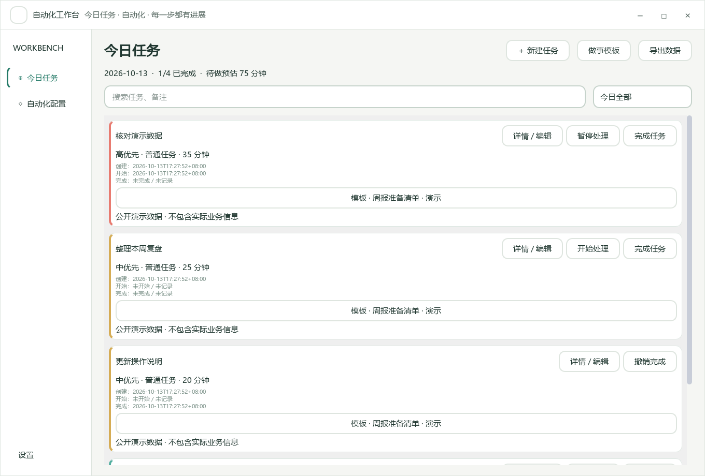
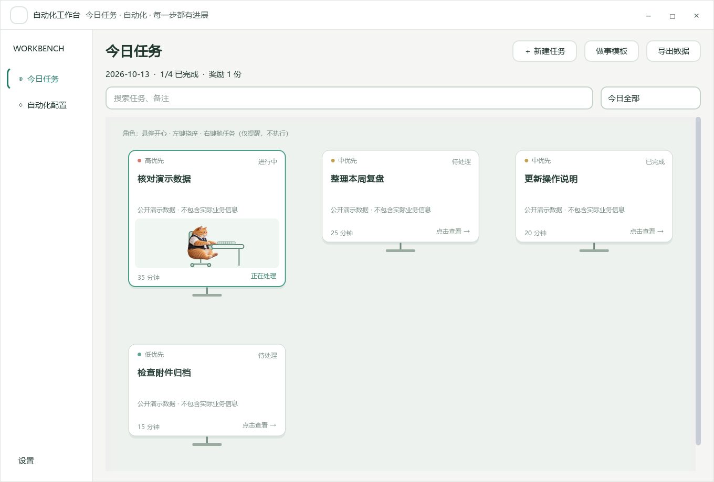
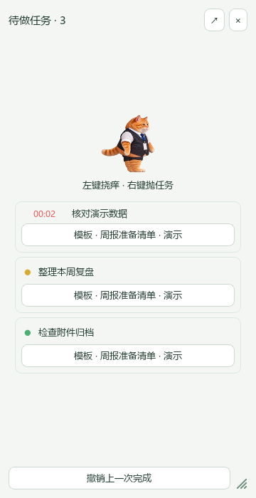
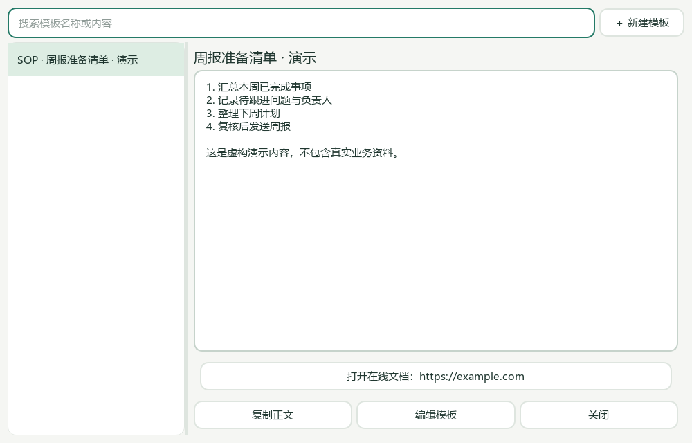
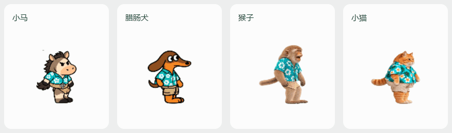

# VBA 工作台 · Harry-S

**把待办、计时、做事模板与桌面陪伴放在一起。** 一个基于 Python / PySide6 / SQLite 的 Windows 桌面应用。

[查看完整案例](https://2631646035-dot.github.io/projects/vba-workbench.html) · [Harry-S 作品集](https://2631646035-dot.github.io/)



## 为什么做

日常办公不只有“勾掉任务”：还要记录实际用时、跟进周期事项、反复查找 SOP 和邮件模板。本项目把这些操作集中到一个本地工作台，再用可选的动物角色互动提供完成反馈，减少界面切换。

## 已实现

- **任务与周期计划**：重要性、预估时间、备注、附件、跟进日期；普通与周期任务统一展示。
- **实际用时**：记录创建、开始、完成时间，支持暂停与继续，当前及历史数据可导出。
- **轻量悬浮窗**：拖动和调整大小；双击开始 / 完成，右键暂停，彩色圆点表示重要性。
- **做事模板库**：SOP、邮件正文、回复话术、附件和在线文档链接；任务标签直达模板。
- **简洁 / 角色工位**：可选小马、腊肠犬、猴子、橘猫，服装、主题及互动反馈。
- **动画工程**：附带 Blender 骨骼工程和预计算动作；日常运行无需安装 Blender。
- **工作流配置编辑器**：可编辑 YAML 步骤定义。公开版不含企业专用执行适配器，不承诺连接业务系统后即插即用。

## 打开与快捷键

1. 在 GitHub 点击 **Code → Download ZIP**，完整解压（不要在压缩包里运行）。
2. 安装 **Python 3.12**，勾选 **Add Python to PATH**。
3. 双击 **打开工作台.bat**。首次需联网安装依赖；初始任务库为空。
4. 双击 **创建桌面快捷方式.bat**，生成使用自定义腊肠犬图标的桌面入口，并尝试设置 **Ctrl + Alt + V**。
5. 更换快捷键：右键桌面图标 → 属性 → 快捷方式 → 快捷键 → 应用。

移动文件夹后重新创建快捷方式。启动错误见 `app/logs/startup.log`；依赖错误见 `app/logs/setup.log`。这是源码运行版，不是免安装 EXE。

开发者也可运行：

```powershell
python -m venv .venv
.\.venv\Scripts\python.exe -m pip install -r app\requirements.txt
.\.venv\Scripts\python.exe app\config_app_v2.py
```

## 实际界面与角色动画

截图由真实程序加载**虚构演示任务**后渲染，不是设计稿。动图是程序实际角色渲染器的动作样例，不代表真实业务绩效。






## 公开范围与安全边界

- 不包含真实任务、历史数据库、个人附件、邮件、公司价卡、WMS 地址、登录凭据或私人工作流。
- 数据默认存储在本机 `app/config`，没有内置云同步；该目录已加入 `.gitignore`。
- `workflow_engine.py` 是通用调度源码，公开 GUI 主要提供配置编辑。企业系统适配器及旧版后台入口未公开。
- 工作流可能调用脚本或文件操作：只加载自己审核过的定义；不要执行来源不明的宏与脚本。
- 不附带第三方软件。若编辑动画，请自行安装 Blender 并在设置中的动画工作室选择可执行文件。
- 公开用于作品展示与技术交流，未授予统一的开源许可；角色素材并不保证具备商业再分发权，如需商用请先核验或替换素材。

## 结构

```text
打开工作台.bat           启动与依赖检查
创建桌面快捷方式.bat     桌面图标 / 快捷键
app/                    桌面程序、角色素材、动画工程
docs/                   合成数据界面演示
```

作者：**Harry-S**。未使用未经核实的“节省工时百分比”等绩效数字。
